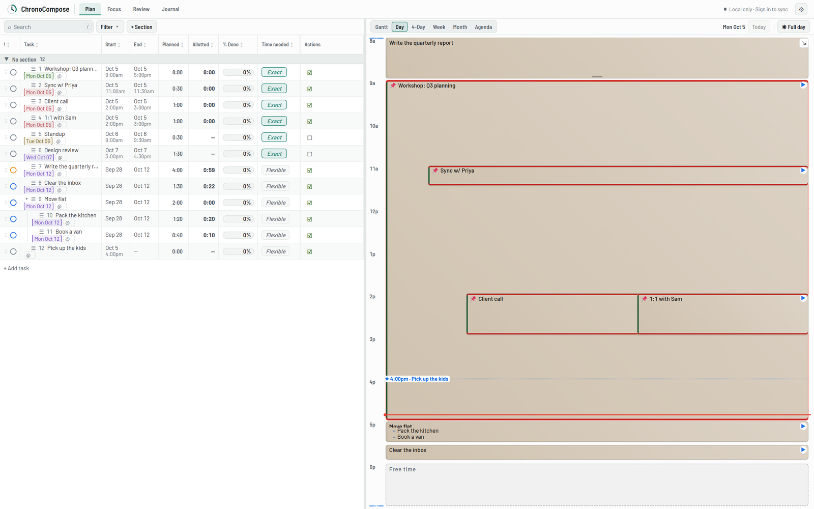
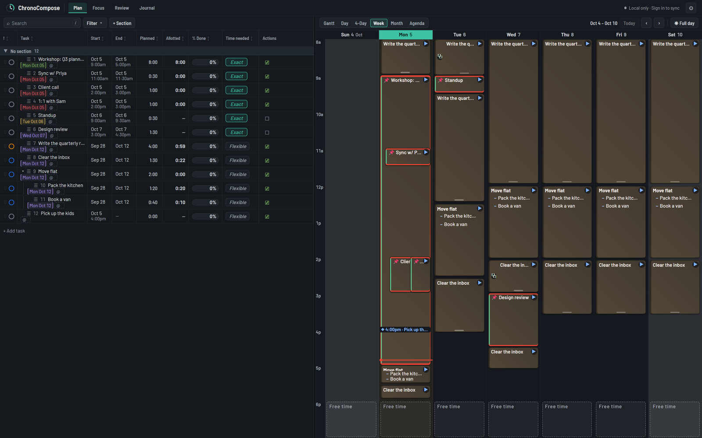
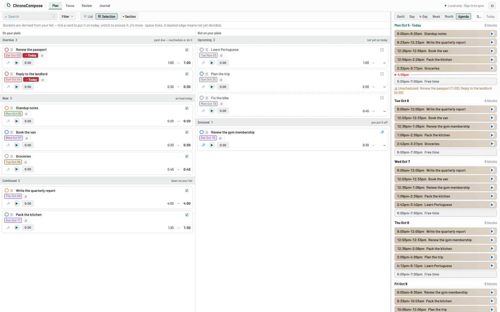

# ChronoCompose

A planner that combines a Gantt chart, a calendar, and an auto-scheduled daily timeline, so that the
long-range plan and today's time budget come from the same task list.

**Live demo:** <https://chrono-compose.vercel.app/> works with no account. Data stays in your browser
until you choose to sign in and sync.



ChronoCompose started as a replacement for a Google Sheets and Apps Script time tracker I had used for
years. It grew into a static single-page app with optional cloud sync and two-way Google Calendar
integration.

## Features

- **One task list, many views.** Gantt, Day, 4-Day, Week, Month and Agenda views all render the same
  tasks. Drag bars to move or resize them, draw dependencies, and see the critical path.
- **Auto-scheduled day.** Fixed appointments are pinned and flexible work is packed into the free time
  around them. Each task gets a daily allotment from its estimate and deadline, and work that does not
  fit is flagged as unscheduled instead of silently dropped.
- **Natural-language quick add.** Type `call plumber fri 2pm for 45m @home` and the parser (built on
  chrono-node) extracts dates, clock times, durations, recurrence and tags.
- **Daily triage.** The Selection view sorts work into Overdue, New, Continued, Upcoming and Snoozed, and
  you decide what goes on today's plate.
- **Time tracking.** Per-task timers, a Pomodoro mode, planned vs. spent time, and a weekly Review.
- **Recurrence, sections, subtasks, habits and a journal.**
- **Google Calendar.** Imports selected calendars and can push local edits back (beta). Durable sign-in
  uses a server-side auth-code flow, so refresh tokens never touch the browser. Push notifications from
  Google arrive through a webhook instead of polling.
- **Offline-first sync.** Without an account the app runs entirely in `localStorage`. With a magic-link
  sign-in it syncs to Supabase, queueing edits while offline and resolving conflicts last-writer-wins.
- **Light and dark themes.**

| Week view (dark) | Selection triage + agenda |
|---|---|
|  |  |

The screenshots use fixture data from the end-to-end suite.

## Architecture

```
Browser (static, no build step)                     Supabase
┌──────────────────────────────────┐   supabase-js  ┌──────────────────────────────────┐
│ index.html  app: state, views,   │◀──────────────▶│ Postgres + Row-Level Security    │
│             scheduler, parser    │   Realtime     │ tasks / habits / journal / ...   │
│ chrono.min.js  date parsing      │                │ Edge Functions (Deno, TypeScript)│
│ config.js      public IDs only   │                │  gcal-oauth   token exchange     │
│ localStorage   source of truth   │                │  gcal-watch   push channels      │
│                                  │                │  gcal-notify  Google webhook     │
└──────────────┬───────────────────┘                └────────────────┬─────────────────┘
               │ Google Identity Services + Calendar API             │ refresh tokens (server only)
               └─────────────────────────▶ Google Calendar ◀─────────┘
```

- **Frontend.** One static `index.html`: a single component class mounted with React from a CDN, with no
  build step. All task mutations go through a single `commit()` path (one undo step each), and the task
  shape is normalized in one place. The scheduling, allotment, recurrence and parsing logic is written as
  pure functions so it can be tested outside a browser.
- **Persistence.** `localStorage` is authoritative on the device and is namespaced per account. Cloud sync
  is an outbox: local writes are queued and pushed, and remote changes arrive over Supabase Realtime.
- **Backend.** The schema lives in [`supabase/migrations/`](supabase/migrations/). Every user table enforces
  `owner_id = auth.uid()` through Row-Level Security. Token and webhook-secret tables have RLS enabled with
  no client policies, so only Edge Functions can read them. [`supabase/tests/rls_isolation.sql`](supabase/tests/rls_isolation.sql)
  checks that one account cannot read or write another account's rows.
- **Secrets.** `config.js` holds only public identifiers: the OAuth client ID, the Supabase URL and the
  publishable key. The Google client secret and the `service_role` key exist only as Supabase function
  secrets.
- **Hosting.** Vercel serves the static files. `vercel.json` publishes only the three runtime files.

Subsystem notes are in [`architecture/`](architecture/README.md).

## Testing

```sh
npm install
npm test             # ~2,100 unit tests: Node's built-in test runner, app loaded in a VM with a mocked DOM
npx playwright install chromium   # once per machine
npm run test:e2e     # ~430 Playwright tests against a real Chromium and a live mount of the app
```

The two layers have separate jobs. Anything that can be proven without a browser is a unit test. The
end-to-end layer covers only what a mocked DOM cannot, such as real pointer input for drag gestures,
layout, and the full page mount.

## Local development

```sh
npm run serve        # static server on http://localhost:8901 (set PORT to change it)
# or: python -m http.server 8000
```

The app runs fully local with no configuration. Google Calendar and cloud sync need your own Google OAuth
client and Supabase project; the steps are in [`SETUP.md`](SETUP.md).

## Repository layout

| Path | Contents |
|---|---|
| `index.html` | The application |
| `config.js` | Public configuration (OAuth client ID, Supabase URL and publishable key) |
| `chrono.min.js` | Bundled date parser (see Third-party code) |
| `supabase/` | Migrations, RLS test, Edge Functions |
| `tests/`, `tests/e2e/` | Unit and Playwright suites |
| `tools/` | Dev server and parser bundle build |
| `architecture/` | Subsystem notes |

## Third-party code

- `chrono.min.js` is a bundle of [chrono-node](https://github.com/wanasit/chrono) (MIT License; notice in
  [`THIRD_PARTY_NOTICES.md`](THIRD_PARTY_NOTICES.md)).
- React, Google Identity Services and supabase-js are loaded from their CDNs at runtime.

## License

Copyright (c) 2026 Kevin Wang. **All rights reserved.**

The source is public so it can be read and evaluated. No license is granted to copy, modify or
redistribute it. The third-party code listed above remains under its own terms.
